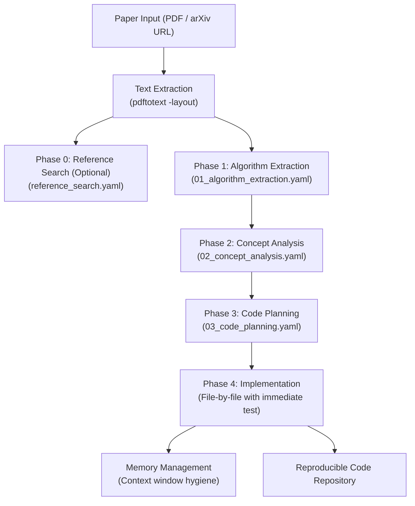

# Source Repository Deep-Dive: Paper2Code

- **Repository**: [issol14/paper2code-skill](file:///references/paper2code)
- **Primary Domain**: Translating Research Papers (PDF/arXiv) into Reproducible, Executable Code
- **Core Technology Stack**: Claude Code Skill, Markdown Behavioral Prompts, Structured YAML Intermediate Representation (IR), Poppler (`pdftotext`).
- **License**: MIT License (Copyright 2025 issol14)

---

## 1. Core Architecture

Paper2Code is an agent skill for Claude Code that enforces a disciplined **4+2 Phase Pipeline** to systematically translate complex research papers into functional code repositories without skipping mathematical or architectural details:



### The 4+2 Phase Pipeline:
1. **Phase 0: Reference Code Search** ([`05_reference_search.md`](file:///references/paper2code/skills/paper2code/05_reference_search.md)): Searches GitHub for existing official or community implementations to identify framework conventions, but enforces that the paper's original specification always overrides reference code.
2. **Phase 1: Algorithm Extraction** ([`01_algorithm_extraction.md`](file:///references/paper2code/skills/paper2code/01_algorithm_extraction.md)): Extracts every algorithm, loss function, equation, and pseudocode block into a structured YAML document.
3. **Phase 2: Concept Analysis** ([`02_concept_analysis.md`](file:///references/paper2code/skills/paper2code/02_concept_analysis.md)): Analyzes underlying theoretical concepts, hyperparameter settings, dataset specifications, and evaluation protocols.
4. **Phase 3: Code Planning** ([`03_code_planning.md`](file:///references/paper2code/skills/paper2code/03_code_planning.md)): Bridges theory and implementation by synthesizing Phases 1 and 2 into an exhaustive implementation plan across 5 mandatory sections.
5. **Phase 4: Implementation Guide** ([`04_implementation_guide.md`](file:///references/paper2code/skills/paper2code/04_implementation_guide.md)): Generates code file-by-file under strict behavioral constraints.
6. **Phase 5: Memory Management** ([`06_memory_management.md`](file:///references/paper2code/skills/paper2code/06_memory_management.md)): Guidelines for context window pruning and file summarization to prevent degradation on long projects.

---

## 2. Input/Output Schemas & Data Structures

The system's core innovation is its **YAML Intermediate Representation**. In [`03_code_planning.md`](file:///references/paper2code/skills/paper2code/03_code_planning.md), the agent is instructed to produce a comprehensive reproduction plan containing 5 required sections:

```yaml
complete_reproduction_plan:
  paper_info:
    title: str
    core_contribution: str

  # Section 1: File Structure (~800-1000 chars)
  file_structure: |
    project_name/
    ├── main.py
    ├── config.py
    ├── models/
    │   ├── __init__.py
    │   └── network.py
    ├── algorithms/
    │   └── core_algorithm.py
    └── tests/
        └── test_core.py

  # Section 2: Implementation Components (~3000-4000 chars)
  implementation_components:
    - component_name: str
      source_reference: "Section 3.2, Eq. (4)"
      target_file: "models/network.py"
      mathematical_formulation: "L_total = L_task + lambda * L_reg"
      pseudocode: |
        def forward(x):
            ...
      hyperparameters:
        learning_rate: 1e-4
        batch_size: 64

  # Section 3: Validation Approach (~2000-2500 chars)
  validation_approach:
    smoke_tests:
      - description: "Verify forward pass with dummy tensor"
        command: "python -m pytest tests/test_core.py"
        expected_output: "All passed"
    expected_metrics:
      metric_name: "accuracy"
      target_threshold: 0.85

  # Section 4: Environment Setup (~800-1000 chars)
  environment_setup:
    python_version: ">=3.10"
    dependencies:
      - "torch>=2.0.0"
      - "numpy>=1.24.0"
    hardware_requirements: "GPU with >= 16GB VRAM"

  # Section 5: Implementation Strategy (~1500-2000 chars)
  implementation_strategy:
    step_order:
      - step: 1
        file: "config.py"
        rationale: "Establish parameters first"
      - step: 2
        file: "models/network.py"
        rationale: "Core architecture"
```

---

## 3. Potential Reusability

- **The Intermediate Representation (IR) Concept**: Paper2Code's separation of paper extraction into an explicit YAML planning artifact before writing code is an essential architectural pattern for Research OS. Directly asking an LLM to generate code from a 15-page PDF produces missing imports, hallucinated tensor shapes, and skipped math steps.
- **Behavioral Control Rules**: The rules defined in [`SKILL.md:L19-46`](file:///references/paper2code/skills/paper2code/SKILL.md#L19-L46) provide gold-standard guidelines for agent code generation:
  - *Generate exactly one file at a time.*
  - *Never ask the user 'Should I implement the next file?' — proceed immediately.*
  - *Paper original specification strictly overrides reference repository conventions.*
  - *Immediate unit testing after each file is authored.*
  - *Focus on runnable correctness first; avoid premature abstraction.*

---

## 4. Weaknesses & Failure Modes

1. **Prompt-Only Execution (No Automated Engine)**:
   - Paper2Code is a collection of Markdown prompt files for Claude Code. It has no autonomous execution engine, API endpoints, or task runner. It requires an interactive human user running Claude Code in a terminal.
2. **No Programmatic Schema Validation**:
   - The YAML schemas are defined only as prompt examples in Markdown. If the LLM generates malformed YAML, omits required sections, or hallucinates syntax, there is no Pydantic parser to catch errors before code generation begins.
3. **Naive PDF Text Extraction**:
   - Uses `pdftotext -layout` ([`SKILL.md:L65`](file:///references/paper2code/skills/paper2code/SKILL.md#L65)), which strips out LaTeX mathematical equations, converts multi-column tables into scrambled plain text, and drops figure captions.
4. **No Sandboxed Execution Environment**:
   - Commands are intended to run directly in the host terminal where Claude Code is active. Running unverified model code directly on the host poses security and reproducibility risks.
5. **No Knowledge Graph or Literature Synthesis**:
   - The tool is designed strictly for single-paper reproduction; it has no multi-paper literature search, cross-paper comparison, or novel ideation capabilities.

---

## 5. Architectural Conflicts with Research OS

| Dimension | Paper2Code Pattern | Research OS Standard | Conflict Resolution |
| :--- | :--- | :--- | :--- |
| **System Type** | Interactive Claude Code Skill | Autonomous, headless OS core | Build headless execution pipeline |
| **Schema Integrity**| Natural language prompt examples | Strict Pydantic v2 validated schemas | Convert YAML prompts into Pydantic models |
| **Execution Safety**| Un-sandboxed host terminal | Isolated Docker / cgroup sandbox | Execute code in isolated containers |
| **PDF Extraction** | `pdftotext` (Poppler) | PyMuPDF + Marker/Nougat math parser | Use high-fidelity PDF extraction pipeline |
| **Scope** | Single-paper reproduction | End-to-end research lifecycle | Integrate with literature & idea stages |

---

## 6. What Research OS Should Do Differently

1. **Formalize into Pydantic Schemas**: Transform the 5-section YAML plan into a formal `ResearchPlanIR` Pydantic model with programmatic validation rules before initiating code generation.
2. **Automated State Machine Orchestration**: Drive the 4-phase pipeline autonomously using the Research OS Voyage execution engine, pausing at human approval gates between Planning (Phase 3) and Implementation (Phase 4).
3. **Containerized Sandbox Execution**: Run generated code and unit tests inside an isolated Docker container with strict CPU/memory/timeout limits, automatically parsing test results into structured JSON test reports.
4. **High-Fidelity Math Parsing**: Replace `pdftotext` with a dual-stream parser (PyMuPDF for layout and Marker for LaTeX math expressions) so that equation numbers in the plan map exactly to LaTeX math strings.
