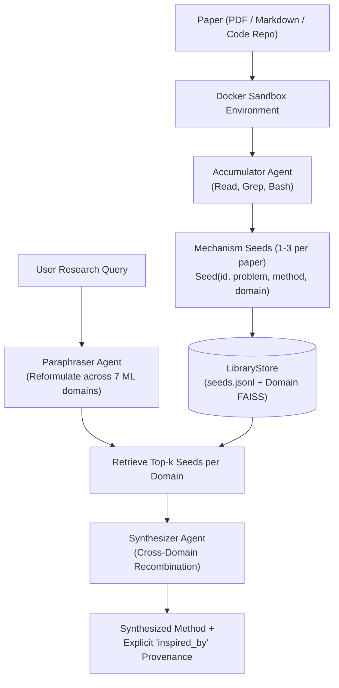

# Source Repository Deep-Dive: PaperGym

- **Repository**: [yunjoochoi/PaperGym](file:///references/papergym)
- **Primary Domain**: Tool-Augmented Paper Distillation & Cross-Domain Mechanism Composition
- **Core Technology Stack**: Python 3.11+, `uv`, FAISS, LiteLLM, Docker, NumPy, Dataclasses.
- **License**: MIT License (Copyright 2026 yun)

---

## 1. Core Architecture

PaperGym introduces two paradigm shifts in literature synthesis and ideation:
1. **Interactive Paper Gym (Active Exploration vs. Passive Ingestion)**: Instead of feeding full paper text to an LLM in one massive context window, PaperGym places an agent inside a Dockerized paper container equipped with `Read`, `Grep`, and `Bash` tools. The agent actively investigates the paper text, formulas, and cloned code repository to distill 1–3 precise **mechanism seeds**.
2. **Cross-Domain Mechanism Composition**: Rather than retrieving prior work only from the query's native subfield, PaperGym paraphrases the query across 7 distinct ML domains, retrieves grounded mechanism seeds from each domain, and synthesizes a hybrid method that explicitly cites which mechanism was borrowed from where.



### Key Modules:
- **Accumulator Agent** ([`src/papergym/agents/accumulator/agent.py`](file:///references/papergym/src/papergym/agents/accumulator/agent.py)): Runs an autonomous tool loop over the paper directory, executing targeted searches to extract the core contribution and implementation mechanism.
- **Library Store** ([`src/papergym/library/store.py`](file:///references/papergym/src/papergym/library/store.py)): Domain-partitioned vector index and JSONL store using FAISS `IndexFlatIP` and cosine similarity over `text-embedding-3-small` embeddings.
- **Cross-Domain Synthesizer** ([`src/papergym/agents/synthesizer/`](file:///references/papergym/src/papergym/agents/synthesizer/)): Composes novel research ideas by enforcing explicit mechanism borrowing across disparate fields (e.g. borrowing an optimization trick from Reinforcement Learning to solve an attention bottleneck in NLP).

---

## 2. Input/Output Schemas & Data Structures

PaperGym utilizes Python dataclasses for its foundational schemas:

### Seed Schema ([`src/papergym/library/seed.py`](file:///references/papergym/src/papergym/library/seed.py)):
```python
@dataclass
class Seed:
    seed_id:     str          # 12-char hex UUID (e.g. "a1b2c3d4e5f6")
    problem:     str          # Core limitation/challenge addressed
    method:      str          # Concrete technical mechanism invented
    domain:      Domain       # Enum: LLM_NLP, CV, RL, ROBOTICS, GRAPH, AUDIO, THEORY
    paper_title: str          # Full paper title
    paper_id:    str          # ArXiv ID or Semantic Scholar corpus ID

    def to_dict(self) -> dict:
        d = asdict(self)
        d["domain"] = self.domain.value
        return d
```

### Synthesizer Output Schema (`eval/ideation.py`):
```python
@dataclass
class SynthesizedIdea:
    method: str                              # Complete description of proposed method
    rationale: str                           # Theoretical justification
    inspired_by: list[dict[str, str]]       # Explicit provenance list:
    # [
    #   {
    #     "seed_id": "...",
    #     "paper_title": "...",
    #     "domain": "...",
    #     "borrowed_aspect": "Exact mathematical or algorithmic mechanism adopted"
    #   }
    # ]
```

---

## 3. Potential Reusability

- **The `Seed` Abstraction**: Atomic extraction of `(problem, method, domain)` mechanisms from papers is clean, modular, and directly applicable to Research OS's knowledge graph.
- **Cross-Domain Recombination**: The algorithm that paraphrases research goals into neighboring subfields to retrieve cross-domain seeds produces measurably higher novelty and methodological diversity than single-domain retrieval.
- **Active Exploration Tool Loop**: The pattern of providing an LLM with `Read`, `Grep`, and `Bash` tools inside an isolated environment yields higher-fidelity technical understanding than brute-force document summarization.
- **Benchmarking Suite**: PaperGym contains a mature evaluation harness in [`eval/`](file:///references/papergym/eval/) and [`scripts/`](file:///references/papergym/scripts/) with shuffle tests, grounding checks, and multi-condition ablation studies that Research OS can adapt.

---

## 4. Weaknesses & Failure Modes

1. **POSIX-Only File Locking (`fcntl`)**:
   - In [`store.py:L1`](file:///references/papergym/src/papergym/library/store.py#L1), the code unconditionally imports `fcntl` for flock operations. This crashes immediately on native Windows environments with `ModuleNotFoundError: No module named 'fcntl'`.
2. **Brittle Regex JSON Extraction**:
   - In [`accumulator/agent.py:L33-39`](file:///references/papergym/src/papergym/agents/accumulator/agent.py#L33-L39), JSON is extracted from LLM responses using regex searching for code fences (`_extract_json`). If the LLM generates unescaped quotes or invalid formatting, the accumulator discards all seeds and fails silently.
3. **No Code Implementation or Experiment Execution**:
   - PaperGym's pipeline ends after synthesizing the methodology text. It does not generate code, run simulations, or verify the proposed ideas empirically.
4. **LLM-as-a-Judge Evaluation**:
   - Evaluating whether a synthesized method is viable or novel relies on prompt-based LLM judges, which are prone to hallucination and lack physical ground truth.

---

## 5. Architectural Conflicts with Research OS

| Dimension | PaperGym Pattern | Research OS Standard | Conflict Resolution |
| :--- | :--- | :--- | :--- |
| **OS Portability** | POSIX `fcntl` file locking | Cross-platform locking (`portalocker` / DB) | Replace `fcntl` with database transactions |
| **Data Models** | Python `dataclass` + dict casting | Strict Pydantic v2 validated schemas | Convert `Seed` to Pydantic model |
| **JSON Extraction** | Regex fence matching | Structured Outputs (`response_format`) | Enforce API-level JSON schemas |
| **Lifecycle** | Ideation only (stops at text) | End-to-end (Literature → Code → Verified Run) | Connect synthesizer to planning and execution |

---

## 6. What Research OS Should Do Differently

1. **Pydantic Schema Migration**: Upgrade `Seed` and `SynthesizedIdea` to Pydantic v2 models with runtime type validation and automatic JSON serialization.
2. **Cross-Platform Relational Persistence**: Replace `fcntl`-locked `seeds.jsonl` with an ACID-compliant database (SQLite or PostgreSQL with `pgvector`), eliminating OS portability bugs and lock contentions.
3. **Pipeline Integration**: Feed PaperGym's `SynthesizedIdea` directly into Research OS's Paper2Code planning engine (`ResearchPlanIR`) to automatically translate the synthesized cross-domain concept into an executable PyTorch project.
4. **Empirical Verification**: Replace LLM-as-a-judge evaluations with containerized dry runs, smoke tests, and metric threshold assertions.
