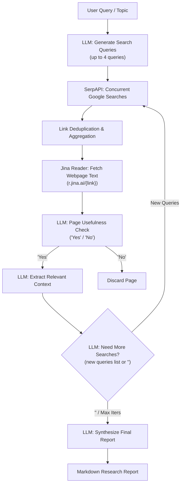

# Source Repository Deep-Dive: research_assistant (mshumer)

- **Repository**: [mshumer/ai-researcher](file:///references/ai-researcher) & [mshumer/OpenDeepResearcher](file:///references/OpenDeepResearcher) (mirrored in [`references/research_assistant`](file:///references/research_assistant))
- **Primary Domain**: Iterative Deep Web Research & Report Synthesis
- **Core Technology Stack**: Python (Jupyter Notebook / Google Colab), `aiohttp`, `asyncio`, SerpAPI, Jina Reader API, OpenRouter (Claude 3.5 Haiku / Sonnet).
- **License**: MIT License (Copyright 2025 mshumer)

---

## 1. Core Architecture

The repository implements an iterative web research agent that gathers information until an LLM judge decides sufficient context has been acquired:



1. **Query Generation Loop**: The agent takes a topic, generates up to 4 search queries, and sends them to SerpAPI concurrently via `aiohttp`.
2. **Page Scraping & Relevance Filtering**: Unique links are fetched through Jina's reader service (`https://r.jina.ai/<url>`). The first 20,000 characters of each page are evaluated by Claude Haiku to determine relevance ("Yes" or "No"). Relevant pages undergo an extraction pass to produce context snippets.
3. **Termination Condition**: Aggregated contexts are fed back into the LLM. The model returns either a Python-formatted list of new search queries or the termination token `<done>`.
4. **Synthesis Pass**: All accumulated contexts are passed to the model in a single prompt to draft a comprehensive markdown report.

---

## 2. Input/Output Schemas & Data Structures

The system lacks formal schemas or data classes. All data is handled as raw strings and in-memory lists:

### In-Memory State Variables:
```python
aggregated_contexts: list[str] = []   # Raw text snippets from relevant pages
all_search_queries: list[str] = []    # History of search queries executed
user_query: str                       # User-supplied initial topic
final_report: str                     # Raw generated markdown string
```

### Parsing Mechanism for Loop Continuation:
```python
# From open_deep_researcher.ipynb
response = await call_openrouter_async(session, messages)
if response:
    cleaned = response.strip()
    if cleaned == "<done>":
        return "<done>"
    try:
        # Dangerous eval of LLM output
        new_queries = eval(cleaned)
        if isinstance(new_queries, list):
            return new_queries
    except Exception as e:
        return []
```

---

## 3. Potential Reusability

- **Iterative Search Termination Pattern**: The concept of allowing the LLM to inspect collected literature snippets and determine whether the search space has converged (`<done>`) or if specific gaps require targeted follow-up queries is a valuable high-level workflow.
- **Concurrent Extraction**: Using asynchronous tasks (`asyncio.gather`) to fetch and evaluate candidate URLs in parallel is an effective pattern for minimizing latency.

---

## 4. Weaknesses & Failure Modes

1. **Remote Code Execution via `eval()`**:
   - The use of Python's built-in `eval()` on unconstrained LLM responses (`eval(cleaned)`) is a critical security vulnerability. If an untrusted website injects a prompt injection payload (e.g. `__import__('os').system('rm -rf /')`), the host machine can be fully compromised.
2. **No Academic Search Integration**:
   - Relies exclusively on commercial Google Search scraping (SerpAPI). It cannot query structured academic databases (Semantic Scholar, OpenAlex, arXiv, PubMed, CrossRef) or filter by peer-reviewed status, citation count, or publication date.
3. **No PDF or Mathematical Structure Parsing**:
   - Relies on Jina's HTML reader, completely ignoring PDF formatting, LaTeX math formulas, tables, figures, and author metadata.
4. **Zero State Persistence**:
   - All state resides in ephemeral notebook variables. A network timeout, rate limit error, or kernel crash destroys the entire research session.
5. **No Verification, Planning, or Code Execution**:
   - The system is purely an informational report writer. It cannot plan experiments, write code, run tests, or verify citations.

---

## 5. Architectural Conflicts with Research OS

| Dimension | research_assistant Pattern | Research OS Standard | Conflict Resolution |
| :--- | :--- | :--- | :--- |
| **Execution Safety** | `eval()` on LLM outputs | Safe Pydantic JSON deserialization | Ban `eval()`; enforce `model_validate_json` |
| **Search Substrate** | SerpAPI web scraping | Academic APIs (arXiv, S2, OpenAlex) | Connect directly to structured scholarly APIs |
| **Extraction Quality**| Stripped webpage HTML text | Full PDF layout & formula extraction | Use PyMuPDF + LaTeX/formula extractors |
| **Session State** | Ephemeral Jupyter variables | Resumable persistent state machine | Store runs in SQLite/PostgreSQL with checkpoints |
| **Deliverables** | Generic narrative report | Verified executable experiment & paper | Extend past text into code & verification |

---

## 6. What Research OS Should Do Differently

1. **Safe Schema Enforcement**: Replace `eval()` with OpenAI/Anthropic structured outputs (`response_format={"type": "json_object"}`) validated against a strict Pydantic model (`class SearchRefinement(BaseModel)`).
2. **Academic Provenance**: Query scholarly APIs (Semantic Scholar, OpenAlex, arXiv) with deterministic DOI and arXiv ID deduplication, preserving citation graphs and bibtex metadata.
3. **Persistent Voyage Checkpoints**: Store each iteration's queries, fetched paper IDs, and extraction summaries in an append-only database table so runs can be paused, inspected, and resumed.
4. **Link to Code Planning**: Connect extracted paper context directly into the downstream Paper2Code research planning pipeline rather than terminating at a narrative summary.
