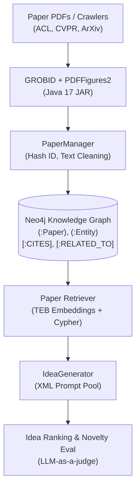

# Source Repository Deep-Dive: SciPIP

- **Repository**: [cheerss/SciPIP](file:///references/scipip)
- **Primary Domain**: Scientific Paper Idea Proposer (NLP, Multimodal, CV)
- **Core Technology Stack**: Python 3.10+, Neo4j Community 5.25+, PyTorch, Hugging Face Transformers, Streamlit, GROBID / `pdffigures2` (Scala/Java 17).
- **License**: MIT License (Copyright 2024 cheerss)

---

## 1. Core Architecture

SciPIP is structured around a three-tier pipeline designed to assist researchers in brainstorming novel research ideas based on domain background queries:



1. **Ingestion & Parsing Layer** ([`src/paper_manager.py`](file:///references/scipip/src/paper_manager.py)):
   - Crawls paper venues (ACL anthology, arXiv, CVPR) via [`paper_crawling.py`](file:///references/scipip/src/utils/paper_crawling.py).
   - Extracts structured sections using `scipdf` ([`src/utils/scipdf/pdf/parse_pdf.py`](file:///references/scipip/src/utils/scipdf/pdf/parse_pdf.py)), which communicates with an external GROBID service and invokes a bundled Scala JAR ([`pdffigures2-assembly-0.0.12-bin.jar`](file:///references/scipip/src/utils/scipdf/pdf/pdffigures2/pdffigures2-assembly-0.0.12-bin.jar)).
   - Segments the paper into introduction, methodology, and experimental sections using heuristic keyword searches.
2. **Knowledge Graph Layer** ([`src/utils/paper_client.py`](file:///references/scipip/src/utils/paper_client.py)):
   - Stores papers in Neo4j as `(:Paper)` nodes.
   - Extracts entity terms via LLM prompts and creates `(:Entity)` nodes.
   - Creates bidirectional co-occurrence relationships `(:Entity)-[:RELATED_TO]->(:Paper)` and citation links `(:Paper)-[:CITES]->(:Paper)`.
   - Builds Neo4j vector search indexes (`CREATE VECTOR INDEX paper-embeddings FOR (p:Paper) ON (p.embedding)`).
3. **Ideation & Prompt Pipeline** ([`src/generator.py`](file:///references/scipip/src/generator.py)):
   - Driven by XML-templated prompts stored in [`assets/prompt/`](file:///references/scipip/assets/prompt/):
     - `generate_problem.xml`: Formulates a research problem from background context.
     - `generate_inspiration.xml`: Identifies methodological inspirations from retrieved graph neighbors.
     - `generate_idea.xml`: Combines the problem and inspirations into candidate ideas.
     - `novelty_eval.xml`: Evaluates idea novelty against ground-truth papers.

---

## 2. Input/Output Schemas & Data Structures

SciPIP does not use typed Pydantic models. All data flows through untyped dictionaries with implicit key conventions:

### Paper Node Data (`paper_client.py`):
```python
# Untyped dictionary representation
paper = {
    "hash_id": str,          # MD5 or generated hash of title/url
    "title": str,            # Cleaned paper title
    "abstract": str,         # Paper abstract
    "introduction": str,     # Extracted intro section
    "methodology": str,      # Extracted methodology text
    "reference": list[str],  # Raw reference strings
    "reference_filter": list[str], # Filtered citation keys
    "year": str,             # Publication year (e.g. "2024")
    "venue": str,            # Conference/Journal name (e.g. "ACL")
    "embedding": list[float] # Dense vector embedding
}
```

### Generated Idea Schema (`generator.py`):
```python
# Extracted via string search for "**Idea {i}"
idea_output = {
    "problem": str,          # Substring between "**Research Problem**" and "**Rationales**"
    "raw_ideas": str,        # Raw LLM completion text
    "ideas": list[str],      # Extracted list of strings split by "**Idea {i}"
    "filtered_ideas": str    # Ideas filtered against background constraints
}
```

---

## 3. Potential Reusability

- **Graph Topology Formulation**: The graph model linking papers and extracted scientific entities (`(:Entity)-[:RELATED_TO]->(:Paper)` and `(:Paper)-[:CITES]->(:Paper)`) is clean and conceptually sound for literature discovery.
- **Prompt Strategy**: The step-by-step ideation decomposition (Problem Formulation → Inspiration Extraction → Cross-Paper Integration → Novelty Filtering) provides a useful prompt-engineering reference.

---

## 4. Weaknesses & Failure Modes

1. **Security Vulnerability (Cypher Injection)**:
   - In [`paper_client.py:L61-63`](file:///references/scipip/src/utils/paper_client.py#L61-L63):
     ```python
     query = f"""
         MATCH (p:Paper {{hash_id: {paper_id}}})
         RETURN p
     """
     ```
     Unescaped f-string interpolation into Cypher queries allows arbitrary database injection if `paper_id` contains malicious characters.
2. **Brittle String-Based Output Parsing**:
   - In [`generator.py:L35-48`](file:///references/scipip/src/generator.py#L35-L48), ideas are parsed by iterating from 1 to 100 searching for the magic substring `f"**Idea {i}"`. If the LLM alters formatting, capitalizes differently, or outputs Markdown bullet points, the parser fails silently.
3. **Heavy External Dependencies**:
   - Requires a running Neo4j database instance, Java JDK 17, and GROBID server. The codebase bundles a precompiled Scala binary JAR (`pdffigures2-assembly-0.0.12-bin.jar`).
4. **No Code Generation, Planning, or Execution**:
   - SciPIP stops completely at text generation. It does not produce actionable research plans, executable code, test suites, or empirical verification.
5. **Heuristic Section Parsing**:
   - In [`paper_manager.py:L31-60`](file:///references/scipip/src/paper_manager.py#L31-L60), methodology detection relies on keyword substrings (`"experiment"`, `"evaluation"`, `"relate"`, `"previous"`). In papers with non-standard section headers, large portions of text are incorrectly sliced or discarded.

---

## 5. Architectural Conflicts with Research OS

| Dimension | SciPIP Pattern | Research OS Standard | Conflict Resolution |
| :--- | :--- | :--- | :--- |
| **Data Integrity** | Untyped `dict[str, Any]` | Strict Pydantic v2 models | Reject untyped dicts; enforce typed schemas |
| **Persistence** | External Neo4j JVM daemon | Embedded SQLite / PostgreSQL with pgvector | Replace Neo4j with embedded/Postgres store |
| **Security** | Cypher string interpolation | Parameterized queries & ORM | Never format query strings dynamically |
| **Ideation Output**| Unstructured markdown text | Structured Pydantic `ResearchHypothesis` | Require structured JSON outputs |
| **Lifecycle** | Ideation only (stops at text) | Full lifecycle (Literature → Code → Experiment → Verification) | Implement downstream execution stages |

---

## 6. What Research OS Should Do Differently

1. **Eliminate Neo4j & JVM Daemons**: Use PostgreSQL + `pgvector` (or SQLite + `sqlite-vec` for local development) to model entities, citations, and embeddings within a unified relational store without Java dependencies.
2. **Replace Grobid/PDFFigures2**: Utilize PyMuPDF for robust PDF parsing and Nougat/Marker for mathematical formula fidelity.
3. **Structured Outputs**: Replace XML prompts and brittle `**Idea 1` substring splitting with strict JSON Schemas validated via Pydantic (`client.chat.completions.create(response_format=...)`).
4. **Connect Ideation to Code**: Feed generated research hypotheses directly into Research OS's structured research planning and code execution harness.
